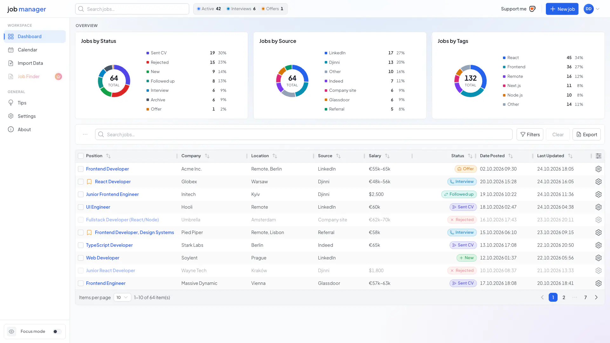

## Hi, I'm Denys 👋

Frontend developer in Frankfurt am Main, building web apps with **React, TypeScript, Lit / Web Components and Node.js**.

## 🚀 Janager: [janager.me](https://janager.me)

A free job application tracker I designed, built and run on my own, from UI to API to server.

<a href="https://janager.me">
  <picture>
    <source media="(prefers-color-scheme: dark)" srcset="images/dashboard-preview-dark.webp">
    
  </picture>
</a>

- **Tracker:** every application, follow-up and interview in one table, with status charts, a calendar and an archive
- **Job Finder:** searches 38 job boards at once with
  title, location, date and work mode filters, and adds matches to the tracker in one click
- **CSV import / export:** bring an Excel or Google Sheets history along, with column matching and validation
- **Accounts:** email sign-up with verification, Google sign-in, password reset
- **4 languages** (EN, DE, UK, ES), light and dark themes

## 🛠️ Tech

**Frontend:** React, TypeScript, JavaScript, Lit, Web Components, Backbone.js, HTML, SCSS, Vite, TanStack Query  
**Backend:** Node.js, NestJS, MongoDB, REST APIs, JWT / OAuth  
**Tools:** Git, ESLint, Prettier, Docker, Coolify

## 📫 Contact

[LinkedIn](https://www.linkedin.com/in/denys-dmytruk-683044247) · [janager.me](https://janager.me)
